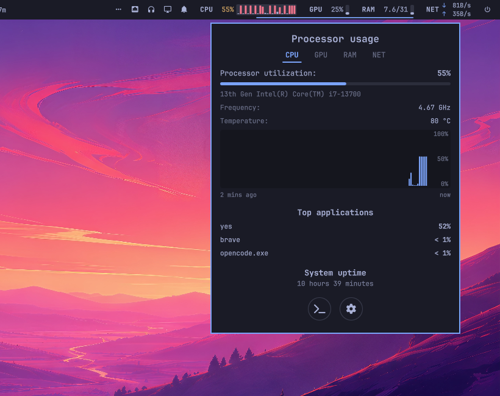

# TopStats

[](https://buymeacoffee.com/kaplanhalil)

A native Omarchy bar widget for **CPU, GPU, RAM, and network** with a compact
Omarchy-native readout and a matching details panel.

TopStats shows four metrics as text label + value + micro meter in the bar.
Clicking CPU, GPU, or RAM opens a theme-aware card with capacity bars, a
two-minute history chart, top processes, and uptime; NET opens live rates,
boot totals, and the active interface. The implementation is original
Omarchy/Quickshell QML.



## Features

- CPU utilization, per-core bars, frequency, package temperature, and uptime.
- White / amber / red meters at 50% and 75%; each core is colored independently.
- Text labels (`CPU`, `GPU`, `RAM`, `NET`) in the bar instead of icons.
- Compact upload/download rates with a NET tab for live rates and boot totals.
- Top three applications by CPU (share of total system), memory, or GPU activity — never an empty list.
- NVIDIA GPU utilization, VRAM, temperature, power, driver, and per-process
  GPU activity (via `nvidia-smi pmon`).
- AMD GPU support through `amdgpu` sysfs (`gpu_busy_percent`,
  `mem_info_vram_*`, hwmon temperature and power).
- RAM and swap usage with available/total sizes; the bar shows used/total GiB.
- Two-minute history charts with a 100/50/0 scale.
- Follows the active Omarchy theme, font, corner radius, and accent color.
- Hover tooltips on each bar metric.
- No root, no background daemon, and no outbound connections.

## Requirements

- Omarchy Quattro (4.x) with the Quickshell shell.
- **NVIDIA:** `nvidia-utils` supplies `nvidia-smi` (normally already installed).
- **AMD:** no extra package; reads `/sys/class/drm/...`.
- **btop:** optional, only for the terminal button in the panel. It is already
  present on most Omarchy systems; install it with your package manager if not.

If no supported GPU is found, the GPU segment and tab are hidden automatically.

## Install

```bash
omarchy plugin add https://github.com/KaplanHalil/omarchy-topstats.git --enable
```

If the widget is not placed automatically:

```bash
omarchy plugin enable io.github.kaplanhalil.topstats --section right --before omarchy.power
```

You can also drag it in the bar, or move it later with:

```bash
omarchy bar move io.github.kaplanhalil.topstats --section right
```

## Use

- **Left click** a metric: open the details panel on CPU, GPU, RAM, or NET.
- **Right click** a metric: open btop.
- **Esc**: close the panel.
- **Left/Right** (or `h`/`l`): switch tabs.
- **1 / 2 / 3 / 4**: jump to CPU / GPU / RAM / NET.
- **r**: refresh the process lists.
- **s**: toggle the settings page.
- The round buttons at the bottom open btop and the settings page.

The bar automatically switches to a compact label + meter layout when the bar
is placed on the left or right edge.

## Settings

Open the gear in the panel, or edit the widget entry in
`~/.config/omarchy/shell.json`:

```json
{
  "id": "io.github.kaplanhalil.topstats",
  "showCpuValue": true,
  "showGpuValue": true,
  "showRamValue": true,
  "showNetwork": true,
  "cpuStyle": "cores",
  "gpuDevice": "auto",
  "interval": 1000,
  "gpuInterval": 2000
}
```

| Key | Default | Values | Meaning |
| --- | --- | --- | --- |
| `showCpuValue` | `true` | boolean | Show the CPU percentage in the bar |
| `showGpuValue` | `true` | boolean | Show the GPU percentage in the bar |
| `showRamValue` | `true` | boolean | Show RAM used/total in the bar |
| `showNetwork` | `true` | boolean | Show the NET upload/download segment |
| `cpuStyle` | `"cores"` | `"meter"`, `"cores"` | One bar per logical CPU or a single bar |
| `gpuDevice` | `"auto"` | `"auto"`, `"nvidia"`, `"amd"`, `"off"` | GPU backend |
| `interval` | `1000` | milliseconds ≥ 500 | CPU/RAM sampling interval |
| `gpuInterval` | `2000` | milliseconds ≥ 1000 | GPU polling interval |

The older `showValues` key is still accepted as a fallback when the
per-metric keys are absent.

Settings changed in the panel are written back to `shell.json` through
Omarchy's normal bar-entry update path.

> **GPU power note:** every `nvidia-smi` call briefly wakes the discrete GPU.
> The default 2-second interval is responsive; raise `gpuInterval` to 5–10
> seconds if idle power matters more than chart resolution.

## How it reads data

| Metric | Source |
| --- | --- |
| CPU | `/proc/stat` deltas, `/proc/cpuinfo`, `coretemp`/`k10temp` hwmon |
| RAM / swap | `/proc/meminfo` (`used = total - available`) |
| NVIDIA | `nvidia-smi --query-gpu`, `nvidia-smi pmon` for processes |
| AMD | `/sys/class/drm/card*/device/` sysfs |
| Processes | `/proc/<pid>` via `ps` (CPU is an instantaneous delta, not a lifetime average) |
| Network | `/proc/net/dev` deltas sampled every 2 s, loopback excluded, summed across active interfaces |
| Uptime | `/proc/uptime` |

All sampling happens locally. TopStats opens no network connections and does
not request elevated privileges.

## Remove

```bash
omarchy plugin remove io.github.kaplanhalil.topstats
```

## Development

```bash
PLUGIN_DIR="$HOME/.config/omarchy/plugins/io.github.kaplanhalil.topstats"
omarchy plugin validate "$PLUGIN_DIR"
omarchy-shell shell rescanPlugins
```

Quickshell resolves `qs.Commons` and `qs.Ui` from the shell directory; plain
`qmllint` needs a small module root that mirrors that mapping:

```bash
LINT_ROOT="${XDG_RUNTIME_DIR:-/tmp}/topstats-qml"
mkdir -p "$LINT_ROOT/qs"
ln -sfn "$OMARCHY_PATH/shell/Commons" "$LINT_ROOT/qs/Commons"
ln -sfn "$OMARCHY_PATH/shell/Ui" "$LINT_ROOT/qs/Ui"
qmllint -I "$LINT_ROOT" "$PLUGIN_DIR"/*.qml
```

The plugin folder must be at the repository root: `manifest.json`,
`BarWidget.qml`, and `Panel.qml` are loaded directly from it.

## Support

If TopStats is useful to you, you can buy me a coffee:

[Buy Me a Coffee](https://buymeacoffee.com/kaplanhalil)

## Credits and license

TopStats is an independent implementation for Omarchy, written as original
Omarchy/Quickshell QML.

TopStats is released under the MIT license. See [LICENSE](LICENSE).
